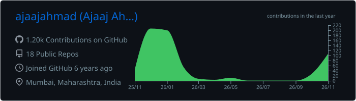
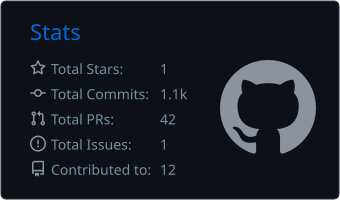
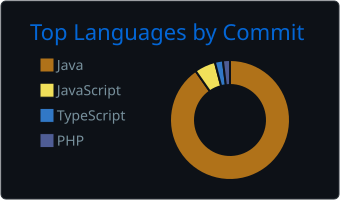

<h1 align="center">Hi, I'm Ajaaj Ahmad 👋</h1>
<h3 align="center">QA Automation Engineer | Java · Selenium · TestNG · CI/CD</h3>

  
  

---

### 🧪 About me

- SDET with **4.5+ years** at ValueFirst (including a 1-year QA traineeship), testing **Infinito**, a multichannel CPaaS platform (SMS, WhatsApp, RCS, Email).
- Designed and owned a **hybrid automation framework** (Java, Selenium, TestNG, Cucumber, Rest Assured, Maven, POM) with parallel execution, Extent Reports, and Log4j2 logging.
- Build **Jenkins** and **GitHub Actions** pipelines with **Docker** that run smoke and regression suites on every build.
- Test **GenAI / LLM-driven features**: AI template generation, campaign workflows, and analytics.
- 🔭 Open to **SDET / QA Automation** roles.

---

### 🏆 Awards

- **Star of the Quarter (Dec 2023)**: awarded for designing and developing a hybrid automation framework.

---

### 🛠️ Tech stack

**Language & automation** 

**API & database** 

**CI/CD & tools** 

---

### 📊 GitHub stats

  

  
  

  

